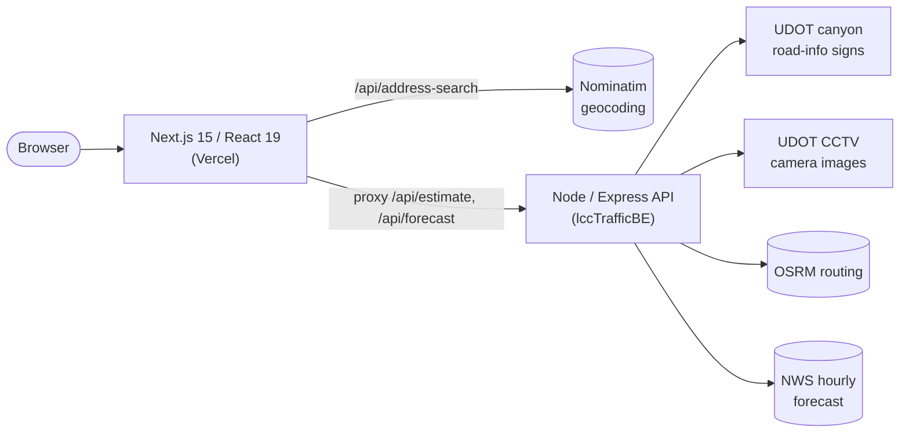

# Little Cottonwood / Alta Drive Time

**Real-time drive-time estimates from your door to Alta, built on live UDOT canyon signs, traffic cameras and weather.**

🔗 **Live app: [lcc-traffic-fe.vercel.app](https://lcc-traffic-fe.vercel.app)**  ·  Backend: [T-dex/lccTrafficBE](https://github.com/T-dex/lccTrafficBE)

<!-- TODO: add a screenshot or short GIF here, ideally captured on a busy powder morning -->
<!--  -->

---

## Why I built it

<!-- TODO: rewrite this in your own words -->
On a powder day, the drive up Little Cottonwood Canyon can take 20 minutes or two hours, and the UDOT signs only tell you about the canyon itself, not the trip from your house. I wanted one number I could check before leaving: *how long will it take me to get to Alta right now, and will it get better or worse if I wait?*

## What it does

- **Door-to-Alta estimate.** Type an address (with autocomplete) and get a total drive time, broken down by segment.
- **Live canyon conditions.** Reads the UDOT canyon-top travel-time sign and flags alerts like closures, avalanche control, chain and traction restrictions.
- **Camera-based congestion.** Scores live UDOT traffic camera images along the canyon and its approaches.
- **3-hour outlook.** Predicts whether the canyon will be *Normal*, *Slower* or *Stopped* later, combining current traffic, ski-traffic time patterns and the National Weather Service forecast for Alta.
- **Under-90-minutes verdict.** Tells you at a glance whether the trip is likely OK, borderline or long.
- **Auto-refresh.** Updates every 5 minutes while the page is open.

## Architecture



This repo is the **front end**: a TypeScript Next.js app deployed on Vercel. Its API routes proxy estimate and forecast requests to the [Node/Express backend](https://github.com/T-dex/lccTrafficBE), which does the data gathering, image scoring and forecasting. Address autocomplete is handled directly in a Next.js route handler so suggestions stay fast.

## Interesting problems

### Making it feel instant (stale-while-revalidate caching)
A full estimate touches several slow upstream services, so a cold request can take a few seconds. The app saves the last estimate for your address in `localStorage` (valid for 30 minutes) and paints it immediately on load while a fresh estimate is fetched in the background. If a background refresh fails, it **keeps showing the last good data** with a "refresh failed" note instead of blanking the page. The backend adds its own layer of caching (see [lccTrafficBE](https://github.com/T-dex/lccTrafficBE#caching)).

### Staying inside a free geocoder's rate limit
Address autocomplete uses OpenStreetMap's public Nominatim service, which allows about one request per second. Typing quickly would blow through that, so:
- autocomplete is **debounced** (500 ms) and only searches at 4+ characters, and estimate requests wait 800 ms after you stop typing,
- outbound calls are **serialized through a promise chain** and spaced at least 1.1 s apart,
- a `429` response is retried once after honoring the `Retry-After` header (capped at 10 s),
- results are **biased to the Salt Lake valley** without excluding other origins.

### Reliable POST proxying on Vercel
Next.js rewrites handled some JSON POST bodies inconsistently between dev and production, so estimate and forecast calls go through explicit route handlers that forward the body as-is. A `/api/backend-health` route reports whether the backend is reachable and how long it took, which made deployment issues much faster to debug.

## Tech stack

**Front end:** Next.js 15 (App Router), React 19, TypeScript, CSS · deployed on Vercel
**Back end:** Node.js 20, Express, sharp (image analysis) · see [lccTrafficBE](https://github.com/T-dex/lccTrafficBE)
**Data:** UDOT Cottonwood Canyons road information and CCTV cameras, OSRM, Nominatim (OpenStreetMap), National Weather Service API

## Running locally

Requires Node.js 20+. Start the [backend](https://github.com/T-dex/lccTrafficBE#running-locally) first (it listens on port 8765 by default), then:

```bash
cd web
cp .env.local.example .env.local   # BACKEND_URL=http://127.0.0.1:8765
npm install
npm run dev
```

Open http://localhost:3000.

### Deploying
Create a Vercel project with **root directory `web`** and set `BACKEND_URL` to your deployed backend's URL (never `localhost` in production).

## What's next

- **Historical patterns:** log estimates over time to answer "leave by 7:10 to beat the line."
- **Alerts:** notify me when the canyon drops below a chosen drive time.
- **Big Cottonwood support:** the backend config is already structured per canyon.
- **Shared rate limiting:** the geocoding throttle is per serverless instance; a shared limiter (e.g. Redis) would make it airtight under load.
- **Tests:** unit tests for sign parsing and the estimate math.

## Disclaimer

Unofficial personal project, not affiliated with UDOT. Estimates are approximate. Always check [UDOT Cottonwood Canyons](https://cottonwoodcanyons.udot.utah.gov/road-information/) and drive to conditions.
